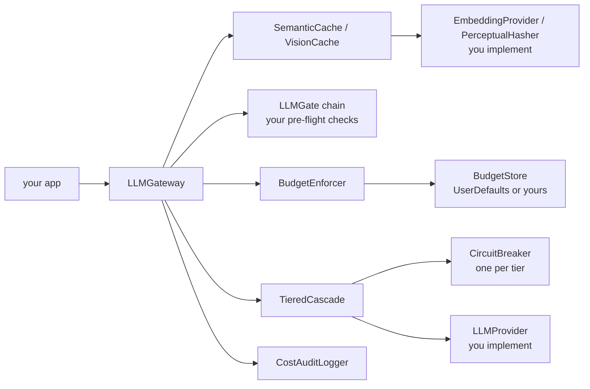

# LLM Gateway Kit

[](https://github.com/OrenSegal/llm-gateway-kit/actions/workflows/ci.yml) [](LICENSE) [](Package.swift)

A Swift package that sits between an app and its LLM providers and handles cost and reliability. Its patterns come from the LLM gateway in Shelfie, my kitchen-inventory iOS app (pre-launch). Shelfie runs its own server-side gateway and does not use this package.

- **Caching.** `SemanticCache` answers a reworded prompt from an earlier response when the embeddings are close enough; `VisionCache` does the same for images by perceptual hash. A hit makes no paid call.
- **Circuit breaker.** Each provider gets a breaker that opens after 5 straight failures (configurable), and `TieredCascade` sends traffic to the next provider instead of retrying a dead one.
- **Spend limits.** `BudgetEnforcer` reserves each call's estimated cost against a daily USD cap before the call goes out, with separate caps for signed-in and anonymous callers, and refuses the call if that would cross the cap.

Run the demo (macOS with Xcode, no API keys, mock providers):

```bash
git clone https://github.com/OrenSegal/llm-gateway-kit.git
cd llm-gateway-kit
make run
```

```text
First call (cache miss, hits the cheap-fast-model tier):
  -> [cheap-fast-model] response to: reset my password (source model: cheap-fast-model)

Second call, a paraphrase (cache hit, zero spend):
  -> [cheap-fast-model] response to: reset my password (source model: cache)

Third call, unrelated prompt (cache miss again):
  -> [cheap-fast-model] response to: what's the weather today (source model: cheap-fast-model)

Audit log: 3 calls, 1 served from cache, 2 hit a paid provider.
```

## How a request flows



A cache hit returns before the budget or any provider is touched. On a miss the gateway runs the gate chain, reserves the estimate, sends through the cascade and records each paid call. Pseudocode for each step is in [DESIGN.md](DESIGN.md).

## Results on a scripted trace

`Tests/LLMGatewayKitTests/TraceReplayTests.swift` replays 22 requests through one `LLMGateway` and asserts every count below, so CI fails if the behavior changes. The traffic is synthetic and the providers are mocks priced at $0.01 (cheap) and $0.05 (backup) per call. It shows what each mechanism does. It is not a measurement of savings on real traffic.

| Phase | Requests | What happened |
|---|---|---|
| Cache | 4 new questions, then 6 rewordings of them | 4 paid calls, 6 served from the semantic cache |
| Spend limit | 5 anonymous questions, $0.035/day anonymous cap | 3 served, 2 refused with `dailyBudgetExceeded` before reaching a provider |
| Outage | Cheap provider down, 7 new questions | All 7 served by the backup; the cheap provider was tried 5 times, then its breaker opened and it was skipped |

Of 22 requests, 14 were answered by a paid provider, 6 by the cache, and 2 were refused. Run it with `make test`. The trace uses a toy one-hot embedding, so "reworded" here means sharing a keyword; it does not measure real paraphrase quality.

Not a Swift reader? [DESIGN.md](DESIGN.md) describes the budget reservation, breaker states and cache keys in pseudocode. [docs/decisions.md](docs/decisions.md) records five design decisions, including the v0.1.0 budget race the reservation fixes.

LLM Gateway Kit has no opinion about your auth, your paywall or your UI. Bring your own provider adapter; the kit handles cost and reliability.

## The three pillars

### 1. Semantic + vision response caching

A plain exact-match cache only helps when a user sends the literal same
string twice. Many requests are paraphrases, like "what should I use
up soon" vs. "what's expiring in my pantry", that an exact-match cache
always misses.

`SemanticCache` embeds each prompt and serves a cached response for any
prompt whose embedding clears a cosine-similarity threshold, so paraphrased
requests hit the cache too. `VisionCache` does the same thing for image
calls using perceptual image hashing (Hamming distance) instead of text
embeddings.

Both are pluggable: you supply your own `EmbeddingProvider` and
`PerceptualHasher` implementations, so the cache works with whatever
embedding model or hashing algorithm you already use.

### 2. Tiered circuit breakers

`CircuitBreaker` is a standard closed → open → half-open breaker per
provider. `TieredCascade` chains providers into an ordered fallback list,
typically a cheap/fast primary and a stronger/pricier backup, and escalates
to the next tier when:

- the current tier's breaker is open (provider is down/degraded), or
- the call itself throws, or
- the response comes back with a confidence score below that tier's floor
  (a *quality* escalation, not just a *failure* escalation)

A call that resolves on the cheap tier costs the cheap tier's price; only
calls that fail or come back below the floor escalate. How many calls
escalate depends on your traffic and is not measured here.

### 3. Budget enforcement

`BudgetEnforcer` is a **pre-flight** check, not a post-hoc dashboard. Each
call reserves its estimated cost against a daily USD cap in one atomic step
before the request goes out, then records what it really cost and gives the
reservation back, on failure too. Calls that start together count against
each other, so a runaway loop, a burst or an abusive/anonymous session gets
refused at the cap. Estimates are rough, so a call can cost more than it
reserved (see Limitations). Ships with:

- separate daily caps for identified vs. anonymous callers (anonymous
  traffic typically needs a much smaller ceiling than authenticated users)
- arbitrary per-scope envelopes (e.g. a smaller sub-budget just for vision
  calls, or per feature/task type)
- a pluggable `BudgetStore` (`UserDefaults` by default; swap in a
  server-backed store if spend needs to be authoritative across devices, and
  make its `reserve` atomic there too)

All three pillars compose through `LLMGate`/`CompositeLLMGate`, a
short-circuiting chain of pre-flight checks (budget, circuit state, your own
kill switches/entitlement checks) that keeps the "should this call even
happen" logic in one place instead of scattered across call sites. `LLMGateway`
enforces the budget it is given whether or not the chain includes `BudgetGate`.

## Where this came from

These patterns come from Shelfie, an iOS app, pre-launch. Its own
server-side gateway (not this package) has a semantic cache, a circuit
breaker and daily spend caps; the app's AI client also keeps a breaker and a
cost cap. One lesson from it: an image cache keyed on a composite of several
photos almost never hits, because two captures of the same scene rarely
produce the same composite. `VisionCache` here only pays off when the same
image really recurs; check that on your traffic before turning it on.
There is no published cost benchmark for this kit. How much it saves depends on how often
your traffic repeats itself and which provider(s) you're calling.

## Install

Swift Package Manager, via Xcode (File → Add Package Dependencies) or in
`Package.swift`:

```swift
dependencies: [
    .package(url: "https://github.com/OrenSegal/llm-gateway-kit.git", from: "0.2.0")
]
```

## Quickstart

```swift
import LLMGatewayKit

// 1. Implement LLMProvider once per vendor you call (OpenAI, Anthropic,
//    Gemini, a self-hosted model...). LLMGatewayKit never talks to a vendor
//    API directly, only ever through this protocol.
struct MyProvider: LLMProvider {
    let identifier = "my-provider"

    func estimatedCostUSD(inputTokens: Int, outputTokens: Int) -> Double {
        Double(inputTokens) * 0.0000003 + Double(outputTokens) * 0.0000006
    }

    func send(_ request: LLMRequest) async throws -> LLMResponse {
        // Call your vendor's SDK/REST API here and map the result.
        LLMResponse(text: "...", usage: LLMUsage(inputTokens: 120, outputTokens: 40), modelID: identifier)
    }
}

// 2. Wire a tiered cascade: a cheap primary and (optionally) a stronger backup.
let cascade = TieredCascade(tiers: [
    CascadeTier(provider: MyProvider(), confidenceFloor: 0.8),
    // CascadeTier(provider: MyStrongerBackupProvider()),
])

// 3. Set a daily budget cap.
let budget = BudgetEnforcer(identifiedDailyCapUSD: 5.0, anonymousDailyCapUSD: 0.50)

// 4. (Optional) Add semantic caching: implement EmbeddingProvider once.
let cache = SemanticCache(embeddingProvider: MyEmbeddingProvider())

// 5. Put it together.
let gateway = LLMGateway(cascade: cascade, budget: budget, semanticCache: cache)

let response = try await gateway.complete(
    LLMRequest(prompt: "what should I use up soon"),
    isAnonymous: false
)
print(response.text)
```

See `Sources/LLMGatewayKitDemo/main.swift` for the complete, runnable example
(`make run`, or `swift run LLMGatewayKitDemo`) using mock providers so you can see the
cache-hit/circuit-breaker/budget behavior without any real API keys.

If your machine has `swiftly` installed and `swift build` fails at the link
step with `ld: unknown option: -no_warn_duplicate_libraries`, a standalone
swiftly toolchain is shadowing Xcode's own toolchain in `$PATH`. Use
`make build` / `make test` / `make run` (or `xcrun swift build` directly) to
force Xcode's toolchain instead.

## Limitations

- **No real provider adapter ships, and none has been run here.** The package has no networking code; every test and the demo use mock providers. Cost accuracy and failure handling against a real vendor depend on the `LLMProvider` you write.
- **The trace is synthetic.** The 22-request replay uses scripted traffic, mock prices and a toy one-hot embedding. It shows that each mechanism fires; it measures neither savings on real traffic nor paraphrase recall of a real embedding model.
- **No production use.** Shelfie, where these patterns come from, runs its own server-side gateway and does not import this package. I don't know of any app that does.
- **Spend can pass the cap by the error in the estimate.** A call reserves a rough estimate priced at the first tier's rate. Text requests count input tokens as characters divided by 4 and assume 256 output tokens when `maxOutputTokens` is unset; vision requests assume a flat 1,300 input tokens and 400 output tokens. A call that escalates to a pricier tier, or uses more tokens than estimated, costs more than it reserved, and spend can pass the cap by that difference. Calls after that are refused.
- **The default budget store is client-side.** `UserDefaultsBudgetStore` is per device. On iOS it resets when the app is deleted; on macOS the preferences can survive a reinstall. Treat it as a guard against runaway loops, not as billing enforcement; use a server-backed `BudgetStore` for that. Days roll over at midnight UTC.
- **Reservations are only atomic inside one store.** The built-in stores hold them in memory, so separate store instances, processes and devices don't see each other's. A server-backed store has to make `reserve` atomic itself, and needs its own expiry for holds left by a client that died mid-call.
- **Scoped envelopes don't reserve.** `canSpend(estimatedCostUSD:scope:capUSD:)` is check-then-record, so calls that start together can all pass it and overshoot a scoped cap by the cost of the calls in flight.
- **A provider call that throws records nothing.** There is no usage to price, so if a vendor bills for a failed call, that cost isn't counted. Recorded cost is whatever your provider's `estimatedCostUSD` computes from the usage it reports.
- **Caches are in memory, unbounded and scanned linearly.** Nothing persists across launches, there is no size cap, and expired entries are never served but still take memory until you call `evictExpired()`. A lookup can compare against every entry (`SemanticCache` always does; `VisionCache` stops at the first match), so lookups slow down as the cache grows.
- **Cache keys have limits.** `LLMGateway` separates cached answers by task type, `maxOutputTokens` and the list of tiers in the cascade. It doesn't know which tier answered, so an answer from a backup tier is reused for that whole cascade. The vision cache compares prompts as exact text, so a reworded question about the same image is a paid call. If you call `SemanticCache` directly, pass your own `scope`. The 0.92 similarity default is a starting point with no published tuning data behind it; measure it on your own traffic.
- **A `recoveryInterval` of 0 removes the probe limit.** The half-open timeout equals `recoveryInterval`, so at 0 every caller counts as replacing a timed-out probe.

## What this is not

- Not an auth or paywall solution. Bring your own (RevenueCat,
  StoreKit, your backend, whatever you already use).
- Not a chat UI kit. It has no SwiftUI views.
- Not tied to any single LLM vendor. The `LLMProvider` protocol is the
  only thing it depends on, and you implement it.

## License

MIT. See [LICENSE](LICENSE).
